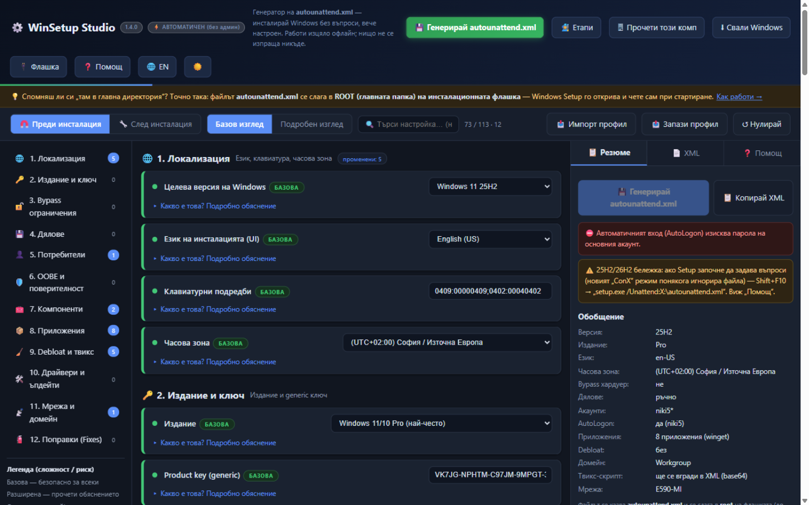
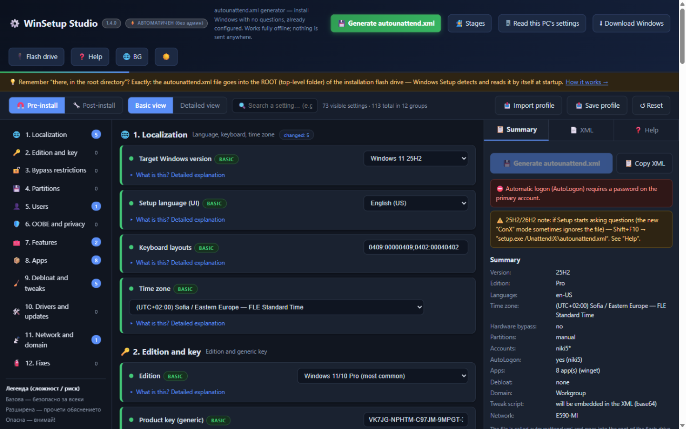
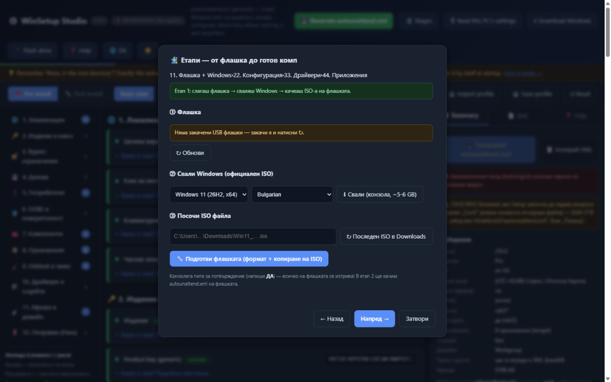

# ⚙️ WinSetup Studio

**Едно клик автоматична инсталация на Windows** — генератор на `autounattend.xml`,
сваляне на официален ISO, подготовка на флашка и авто-инсталация на приложения.

**Български UI · English UI · Офлайн · Отворен код (MIT)**

`irm https://raw.githubusercontent.com/MalinchevART/WinSetupStudio/main/bootstrap.ps1 | iex`

*Стартиране с един ред (PowerShell)*

---

## ✨ Какво прави

| | |
|---|---|
| 🧲 **Преди инсталация** | Конфигуратор с 60+ настройки (11 групи, обяснения на всеки елемент), генерира `autounattend.xml`, подготовка на флашка с `.swm` split за WIM >4 GB |
| 🧙 **Етапи (магьосник)** | Воден флоу: флашка → сваляне на официален Windows ISO → конфигурация → драйвери в `\drivers` → приложения |
| 🔧 **След инсталация** | Същите настройки се прилагат **СЕГА** на живия комп (debloat, поправки, приложения — през админ helper) |
| 👤 **Профили по роля** | 🏠 Домашен · 🏢 Офис · 🖥 Сисадмин · 🌐 Мрежов · 👨‍💻 Разработчик · ⭐ твой собствен профил от скан |
| 📦 **Приложения** | 45+ winget приложения с 1 клик + собствени ID-та |
| 🌐 **BG/EN** | Пълен превод на интерфейса в двете посоки |

## 🖼 Изглед

## 🚀 Бърз старт

1. **🧙 Етапи** → Етап 1: сваля официален Windows ISO (или ползвай existing)
2. Настрой („⚡ Прочети този комп“ препълва формата от твоя комп)
3. **💾 Генерирай autounattend.xml**
4. **🔌 Флашка** — скриптът форматира, копира, разделя WIM >4 GB и слага всичко
5. Boot от флашката → инсталацията тече сама → приложенията се инсталират при първия вход

## 🛡 Сигурност

- Helper-ът работи само на `127.0.0.1` и изисква **сесионен токен** (X-WSS-Token)
- Строг Origin (same-origin само; `Origin: null` / чужди сайтове → 403) + anti-clickjacking
- Removable guard: записва **само на флашки** — никога на системни дискове
- Домейн allowlist за сваляния (lenovo.com / dell.com / hp.com)
- Rate limit + валидация на всички входове · инспектирано от екипи (JS/сиг/UX)

## 📄 Документация

- [Ръководство за потребителя (DOCX, BG)](docs/Ръководство-за-потребителя-v1.4.docx)
- [Скрийншоти (HTML галерия)](docs/screenshots.html)
- [CHANGELOG](CHANGELOG.md) · [ROADMAP](ROADMAP.md) · [QA чеклист](QA_CHECKLIST.md)

## Лиценз

[MIT](LICENSE)
